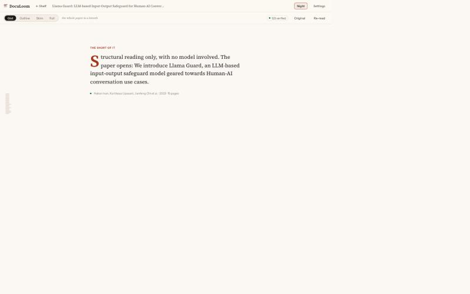
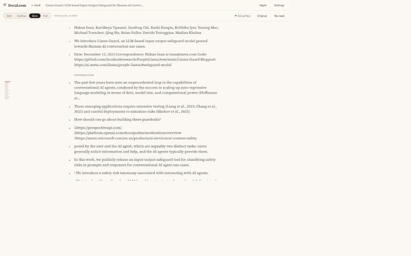
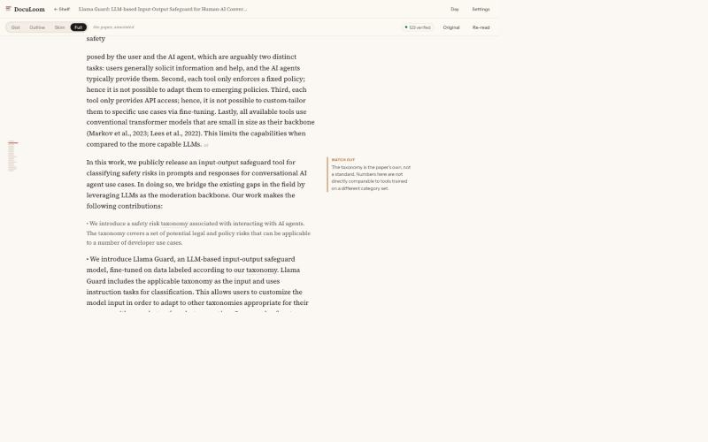

# DocuLoom

A local-first reader for research papers. It does not summarise a paper and
hand you the summary. It prepares the same paper at four depths and lets you
move between them while keeping your place.



## The idea

A paper is a linear argument, so drawing it as a graph either flattens into a
chain or invents links that are not there. What actually makes papers hard is
something else: you cannot choose how much detail you want. You either read
every word or you read an abstract that drops the parts you needed.

DocuLoom gives you one control that moves the whole document along that axis:

| Level | What you see |
|---|---|
| **Gist** | The paper in a few plain sentences. |
| **Outline** | One paragraph per section. |
| **Skim** | One line per paragraph that carries a point. Filler disappears. |
| **Full** | The paper's own text, with notes in the margin. |

Zooming holds your position. If something at Skim catches your eye, you drop
into Full **at that paragraph**, read it properly, and pull back out. Detail
is never gone, only one step away.



## What else is in the reading surface

- **Margin notes.** Short asides beside the paragraph they belong to, typed by
  what they do: *why* a choice was made, *watch out* for a misreading, *what a
  number means*, a *caution*, or missing *background*. Colour tells you which
  before you read it.
- **A glossary that knows this paper.** Technical terms are marked on first use
  in a passage; hovering gives the definition *as this paper uses it*, plus a
  jump to where it is introduced.
- **Evidence, one click away.** Every generated line carries the passage it
  came from. Clicking opens the original PDF at that page, scrolled to the
  cited paragraph, highlighted.
- **A progress rail.** Where you are in the paper and how much is left, without
  a sidebar of links.



*The annotations in this screenshot are illustrative, to show the margin.*

## Trust

Generated text is only useful if you can check it. Every statement cites block
ids that must exist, and quotes text that must actually be in them. Each one
comes out as **direct** (quote found), **inferred** (real sources, wording is
the model's) or **unverified** (nothing real cited), and the tally sits in the
toolbar. Nothing that fails is hidden; it is labelled.

## Running it

```bash
npm install && npm run dev
```

API on `127.0.0.1:5274`, reader on `http://localhost:5273`.

Everything lives under `~/.doculoom` (override with `DOCULOOM_DATA_DIR`): the
PDF, the extracted blocks, the generated lens. Deleting a paper deletes all of
it. Fonts are bundled, so nothing is fetched from a CDN to render a document
you already have.

## Model providers

| Provider | Model | Paper text leaves the machine? |
|---|---|---|
| Claude API | `claude-opus-5-5` | Yes |
| Ollama | configurable (`OLLAMA_MODEL`) | No |
| Offline reader | none | No |

**Offline reader** uses no model. It builds the levels from the paper's own
sentences: each paragraph's opening line becomes its Skim entry, each section's
longest paragraph becomes its summary, and terms come only from acronyms the
paper expands itself. It writes **no margin notes at all**, because explaining
why an author chose something is exactly the part a heuristic cannot do without
inventing it. It exists so the app works before you configure anything.

API keys go to the macOS keychain (or a `0600` file elsewhere), never to the
database and never back to the frontend. `ANTHROPIC_API_KEY` overrides them.

## How it works

```
PDF ─► extraction ─► blocks (+page, +bbox, +section)
                        │
                        ├─► digest (the only block ids the model may cite)
                        │        │
                        │        ▼
                        │     provider ──► JSON draft
                        │                     │
                        │                     ▼
                        │                  validate (zod) ──► repair
                        │                     │
                        └────────────────► verify quotes ──► lens ──► four levels
```

The model returns data, never markup or code, and nothing it returns is
executed. See [docs/architecture.md](docs/architecture.md).

## Tests

```bash
npm test
```

38 tests over layout analysis (gutter detection, line splitting, reading
order), block classification, citation verification, lens repair, and a full
extraction-to-lens run on a real paper.

Fixture PDFs are third-party papers and are not committed. To run the
end-to-end tests:

```bash
mkdir -p fixtures/papers && curl -L -o fixtures/papers/llama-guard.pdf https://arxiv.org/pdf/2312.06674v1
```

Those tests skip rather than fail when the fixture is absent.

## Known limitations

- **Tables extract poorly.** Cell structure is lost, so a table block is often
  interleaved text. Low-confidence passages are flagged with a `?`; the honest
  fallback is the highlighted region in the PDF, which stays correct even when
  the text does not.
- **Scanned PDFs do not work.** There is no OCR. Import warns when a page has
  no extractable text.
- **Equations are located, not parsed.** They are classified and shown as
  extracted text, not rendered as maths.
- **The hosted and Ollama providers have not been exercised against a live
  endpoint** here (no API key, no pulled model). Their request shapes are
  written against the current SDK, and everything downstream — parsing,
  validation, repair, verification — is covered by tests with a stub provider.
  The offline provider has been run end to end.
- **Skim quality depends entirely on the model.** The offline reader's opening
  sentence is a crude stand-in for a paragraph's point, and it shows: author
  lists and URLs become "points". A real provider is what makes Skim worth
  reading.

## Licence

Apache-2.0.
